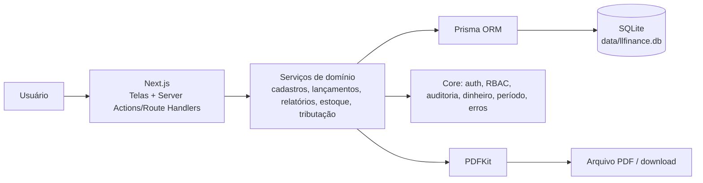
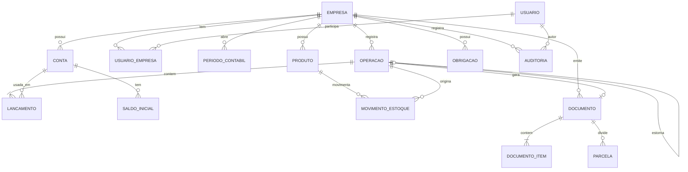

# 02 — Arquitetura e Modelo de Dados

> **Projeto:** LLFinance — Sistema Contábil Educacional  
> **Versão:** 1.0 — 05/11/2026  
> **Público:** as 4 pessoas da equipe

---

## 1. Decisões de arquitetura

### 1.1 Stack recomendada

| Camada | Escolha | Por quê |
|---|---|---|
| Aplicação | **Next.js (App Router) + TypeScript** | Um só projeto para telas, APIs e serviços; roda local; fácil de publicar |
| UI | **React + Tailwind CSS** (+ componentes próprios) | Velocidade, consistência e impressão A4 |
| Banco | **SQLite + Prisma** | Arquivo local, zero instalação de servidor, ideal para notebook; migração futura para PostgreSQL |
| Validação | **Zod** | Mesmo schema no cliente e no servidor; mensagens claras |
| Autenticação | **Cookie `httpOnly` assinado (`jose`) + `bcryptjs`** | Simples, auditável e sem dependência de provedor externo |
| PDF | **PDFKit + `pdfkit-table`** | Controle fino de cabeçalho, tabelas, páginas e rodapé |
| Gráficos | **Recharts** | Dashboard leve e responsivo |
| Planilhas | **SheetJS (`xlsx`)** | Importar/exportar plano de contas e relatórios |
| Testes | **Vitest + Playwright** | Unitário/integração rápido + ponta a ponta real |
| Datas | **date-fns** (`pt-BR`) | Cálculos de período e formatação |
| Qualidade | **ESLint + Prettier + TypeScript strict** | Consistência entre 4 pessoas |

### 1.2 Alternativas consideradas

| Alternativa | Motivo de não adotar agora |
|---|---|
| Python/Django | Ótimo, mas a equipe já vai trabalhar com JavaScript/TypeScript no front; uma stack só reduz atrito |
| Java/Spring | Robusto, porém mais pesado para notebooks e para o prazo escolar |
| PostgreSQL desde o início | Melhor concorrência, mas exige instalação/serviço; SQLite atende o teste local |
| Firebase/Supabase | Depende de internet e de conta; o teste é offline |
| Monorepo com 4 apps | Complexidade desnecessária; módulos dentro de um app resolvem |
| Microserviços | Não se justifica para o escopo e atrapalha a integração |

### 1.3 Por que não dividir por camadas (front / back / banco / QA)

Porque o enunciado pede **cada pessoa com uma parte ponta a ponta**. Dividir por camadas criaria fila: o front espera o back, o back espera o banco, o QA espera tudo. A divisão por **domínio** permite que cada pessoa entregue uma funcionalidade completa e integrável.

---

## 2. Visão geral



**Regra de ouro:** a tela nunca fala com o banco direto. Ela chama um serviço; o serviço valida as regras contábeis e grava com auditoria na mesma transação.

---

## 3. Estrutura de pastas e donos

```text
LLFinance/
├─ prisma/
│  ├─ schema.prisma                 # DONO: Frente A (mudanças via PR revisado)
│  ├─ migrations/                   # DONO: Frente A
│  └─ seed.ts                       # DONO: Frente A (dados base) + D (demo)
├─ src/
│  ├─ core/
│  │  ├─ db.ts                      # DONO: A — cliente Prisma
│  │  ├─ auth.ts                    # DONO: A — login/sessão
│  │  ├─ rbac.ts                    # DONO: A — permissões
│  │  ├─ audit.ts                   # DONO: A — gravação do audit_log
│  │  ├─ money.ts                   # DONO: A — centavos, arredondamento, BRL
│  │  ├─ period.ts                  # DONO: A — exercício e período
│  │  ├─ errors.ts                  # DONO: A — códigos e mensagens
│  │  └─ types.ts                   # DONO: A — tipos compartilhados
│  ├─ modules/
│  │  ├─ cadastros/                 # DONO: A
│  │  ├─ lancamentos/               # DONO: B
│  │  │  ├─ engine.ts               #   criarOperacao, estornar, apurar
│  │  │  ├─ venda.ts                #   lançar venda automática
│  │  │  ├─ compra.ts               #   compra parcelada CP/LP
│  │  │  └─ queries.ts              #   leitura para o Diário (consumido por C/D)
│  │  ├─ relatorios/                # DONO: C
│  │  │  ├─ saldos.ts               #   saldo por conta / período
│  │  │  ├─ razao.ts
│  │  │  ├─ balancete.ts
│  │  │  ├─ balanco.ts
│  │  │  ├─ dre.ts
│  │  │  └─ pdf/                    #   layout e geração
│  │  ├─ estoque/                   # DONO: D
│  │  └─ tributacao/                # DONO: D
│  ├─ app/
│  │  ├─ (auth)/login/              # A
│  │  ├─ (app)/layout.tsx           # A (shell, menu, guarda de sessão)
│  │  ├─ (app)/empresas/            # A
│  │  ├─ (app)/plano-contas/        # A
│  │  ├─ (app)/saldos-iniciais/     # A
│  │  ├─ (app)/usuarios/            # A
│  │  ├─ (app)/auditoria/           # A
│  │  ├─ (app)/lancamentos/         # B
│  │  ├─ (app)/diario/              # B
│  │  ├─ (app)/apropriacao/         # B (apuração)
│  │  ├─ (app)/razao/               # C
│  │  ├─ (app)/balancete/           # C
│  │  ├─ (app)/balanco/             # C
│  │  ├─ (app)/dre/                 # C
│  │  ├─ (app)/relatorios/          # C (PDF completo)
│  │  ├─ (app)/estoque/             # D
│  │  ├─ (app)/obrigacoes/          # D
│  │  └─ (app)/dashboard/           # D
│  └─ components/
│     ├─ ui/                        # base: A; novos componentes: qualquer frente
│     └─ shared/                    # componentes de domínio compartilhados
├─ tests/
│  ├─ unit/                         # cada frente testa seu módulo
│  ├─ integration/                  # serviços + banco
│  └─ e2e/                          # DONO: D
├─ scripts/                         # DONO: D (seed demo, backup, iniciar)
├─ data/                            # SQLite (gitignored)
├─ storage/                         # PDFs gerados, se necessário (gitignored)
└─ docs/                            # todos; contratos e decisões versionados
```

### 3.1 Regras de convivência

1. **Não editar a pasta do outro sem PR e revisão.** Se precisar de um campo, abra issue para o dono.
2. **`prisma/schema.prisma` é território da Frente A.** Mudanças são solicitadas com o modelo e o motivo; A revisa e mergeia.
3. **Contratos primeiro:** antes de codar, a interface vai para `src/core/types.ts` ou para o `queries.ts` do módulo.
4. **Componentes novos:** criar arquivo novo em `components/ui`; não reescrever o componente de outra pessoa.
5. **Migrações:** somente A gera/aplica; as demais frentes trabalham com o schema já mergeado.
6. **Branch por frente:** `feat/a-cadastros`, `feat/b-lancamentos`, `feat/c-relatorios`, `feat/d-estoque`.
7. **PR pequeno:** até ~300 linhas; descrever regra contábil afetada e teste executado.
8. **Integração:** toda quarta e sexta, merge na `main` e rodar a suíte completa.

---

## 4. Modelo de dados

### 4.1 Diagrama entidade-relacionamento



### 4.2 Entidades principais

| Entidade | Para que serve | Campos-chave | Regras/índices |
|---|---|---|---|
| **Empresa** | Cadastro da pessoa jurídica | `id`, `razao_social`, `nome_fantasia`, `cnpj`, `natureza`, `regime`, `endereco`, `capital_social_centavos`, `exercicio_inicio`, `exercicio_fim`, `deleted_at` | `cnpj` único entre ativas; exclusão lógica |
| **Usuario** | Login e autoria | `id`, `nome`, `email`, `senha_hash`, `papel`, `ativo`, `deleted_at` | `email` único |
| **UsuarioEmpresa** | Vínculo usuário ↔ empresa | `usuario_id`, `empresa_id`, `papel` | PK composta; isolamento |
| **Conta** | Plano de contas | `id`, `empresa_id`, `codigo`, `nome`, `tipo`, `natureza`, `grupo`, `conta_pai_id`, `analitica`, `ativa`, `padrao`, `deleted_at` | `(empresa_id, codigo)` único; código ordenável |
| **SaldoInicial** | Saldo de abertura | `id`, `empresa_id`, `conta_id`, `exercicio`, `debito_centavos`, `credito_centavos` | Único por `(empresa, conta, exercicio)`; total D = total C |
| **PeriodoContabil** | Exercício e bloqueio | `id`, `empresa_id`, `exercicio`, `inicio`, `fim`, `status`, `fechado_por`, `fechado_em` | Um aberto por empresa/exercício |
| **Operacao** | Cabeçalho do lançamento | `id`, `empresa_id`, `numero` (`OP-2026-000001`), `data`, `historico`, `tipo`, `status`, `total_centavos`, `criado_por`, `criado_em`, `reversal_of_id`, `replaced_by_id`, `edited_from_id`, `motivo_estorno` | `numero` único por empresa; `data` indexada; status `ATIVA`/`ESTORNADA`/`SUBSTITUIDA` |
| **Lancamento** | Linha débito/crédito | `id`, `operacao_id`, `conta_id`, `tipo` (`DEBITO`/`CREDITO`), `valor_centavos`, `ordem` | `valor > 0`; soma D = soma C por operação |
| **SequenciaDiario** | Numeração sem lacunas | `empresa_id`, `exercicio`, `ultimo_numero` | Atualizada na mesma transação da operação |
| **Parceiro** | Cliente/fornecedor | `id`, `empresa_id`, `tipo`, `nome`, `cpf_cnpj`, `email`, `telefone`, `deleted_at` | `(empresa, cpf_cnpj)` único |
| **Produto** | Item de estoque | `id`, `empresa_id`, `nome`, `sku`, `unidade`, `custo_medio_centavos`, `quantidade`, `estoque_minimo`, `ativo` | `(empresa, sku)` único; quantidade decimal |
| **MovimentoEstoque** | Kardex | `id`, `empresa_id`, `produto_id`, `operacao_id`, `tipo` (`ENTRADA`/`SAIDA`/`AJUSTE`), `quantidade`, `custo_unitario_centavos`, `data`, `criado_por` | Idempotente por `(operacao_id, produto_id, tipo)` |
| **Documento** | Venda/compra | `id`, `empresa_id`, `tipo`, `numero`, `data`, `parceiro_id`, `condicao`, `total_centavos`, `operacao_id`, `status` | Um documento por operação |
| **DocumentoItem** | Itens da venda/compra | `id`, `documento_id`, `produto_id`, `quantidade`, `valor_unitario_centavos`, `custo_unitario_centavos`, `total_centavos` | Soma dos itens = total |
| **Parcela** | Parcelas CP/LP | `id`, `documento_id`, `numero`, `vencimento`, `valor_centavos`, `conta_id`, `operacao_id` | Soma das parcelas = total; CP/LP por conta |
| **Obrigacao** | Roteiro tributário | `id`, `empresa_id`, `tipo`, `competencia`, `vencimento`, `status`, `valor_centavos`, `observacao` | Catálogo por natureza/regime |
| **Auditoria** | Trilha de tudo | `id`, `empresa_id`, `usuario_id`, `entidade`, `entidade_id`, `acao`, `antes_json`, `depois_json`, `ip`, `user_agent`, `criado_em` | Imutável; índice por `(empresa, entidade, entidade_id)` |

### 4.3 Enums × SQLite

SQLite não tem `ENUM` nativo no Prisma. Use `String` no schema + **união de tipos TypeScript + Zod** no domínio:

```ts
export const TIPO_CONTA = ['ATIVO', 'PASSIVO', 'PATRIMONIO_LIQUIDO', 'RECEITA', 'DESPESA', 'CUSTO', 'APURACAO'] as const;
export type TipoConta = typeof TIPO_CONTA[number];
```

Se a equipe migrar para PostgreSQL, os enums podem virar tipos nativos depois.

### 4.4 Dinheiro e datas

- **Dinheiro:** inteiro em **centavos** (`Int`). `R$ 1.234,56` = `123456`. Nunca `float`.
  - Limite seguro do `Int` (32 bits): ~R$ 21,4 milhões por campo. Para o projeto escolar é suficiente; se necessário, migrar para `BigInt`/`Decimal`.
  - Entrada: converter string BRL → centavos no servidor.
  - Divisão: arredondar meio para cima; a diferença de centavos vai para a última parcela.
- **Datas contábeis:** `String` no formato `YYYY-MM-DD` (sem fuso), validada por Zod. `created_at`/`updated_at` como `DateTime`.
- **Formatação:** somente na borda (`Intl.NumberFormat('pt-BR', { style: 'currency', currency: 'BRL' })`).

### 4.5 Esboço do schema Prisma

```prisma
// prisma/schema.prisma — DONO: Frente A
generator client {
  provider = "prisma-client-js"
}

datasource db {
  provider = "sqlite"
  url      = env("DATABASE_URL") // file:./data/llfinance.db
}

model Empresa {
  id                 String   @id @default(cuid())
  razaoSocial        String
  nomeFantasia       String?
  cnpj               String   @unique
  natureza           String   // MEI, EI, SLU, LTDA, SA, COOPERATIVA, ASSOCIACAO, FUNDACAO
  regime             String   // MEI, SIMPLES, PRESUMIDO, REAL
  endereco           String?
  capitalSocialCents Int      @default(0)
  exercicioInicio    String   // YYYY-MM-DD
  exercicioFim       String   // YYYY-MM-DD
  createdAt          DateTime @default(now())
  updatedAt          DateTime @updatedAt
  deletedAt          DateTime?
  deletedBy          String?

  contas      Conta[]
  operacoes   Operacao[]
  periodos    PeriodoContabil[]
  produtos    Produto[]
  auditorias  Auditoria[]

  @@map("empresas")
}

model Conta {
  id         String   @id @default(cuid())
  empresaId  String
  codigo     String
  nome       String
  tipo       String
  natureza   String   // DEVEDORA | CREDORA
  grupo      String?  // CIRCULANTE, NAO_CIRCULANTE, INVESTIMENTO, IMOBILIZADO, INTANGIVEL...
  contaPaiId String?
  analitica  Boolean  @default(true)
  ativa      Boolean  @default(true)
  padrao     Boolean  @default(false)
  createdAt  DateTime @default(now())
  deletedAt  DateTime?

  empresa  Empresa  @relation(fields: [empresaId], references: [id])
  pai      Conta?   @relation("HierarquiaConta", fields: [contaPaiId], references: [id])
  filhas   Conta[]  @relation("HierarquiaConta")
  linhas   Lancamento[]

  @@unique([empresaId, codigo])
  @@index([empresaId, tipo])
  @@map("contas")
}

model Operacao {
  id             String   @id @default(cuid())
  empresaId      String
  numero         String
  data           String   // YYYY-MM-DD
  historico      String
  tipo           String   // MANUAL, VENDA, COMPRA, SALDO_INICIAL, ESTORNO, APURACAO, AJUSTE_ESTOQUE
  status         String   @default("ATIVA") // ATIVA, ESTORNADA, SUBSTITUIDA
  totalCents     Int
  criadoPor      String
  criadoEm       DateTime @default(now())
  reversalOfId   String?
  replacedById   String?
  editedFromId   String?
  motivoEstorno  String?

  empresa    Empresa      @relation(fields: [empresaId], references: [id])
  linhas     Lancamento[]
  reversalOf Operacao?    @relation("Estorno", fields: [reversalOfId], references: [id])
  estornos   Operacao[]   @relation("Estorno")

  @@unique([empresaId, numero])
  @@index([empresaId, data])
  @@map("operacoes")
}

model Lancamento {
  id          String @id @default(cuid())
  operacaoId  String
  contaId     String
  tipo        String // DEBITO | CREDITO
  valorCents  Int
  ordem       Int    @default(0)

  operacao Operacao @relation(fields: [operacaoId], references: [id], onDelete: Cascade)
  conta    Conta    @relation(fields: [contaId], references: [id])

  @@index([operacaoId])
  @@index([contaId])
  @@map("lancamentos")
}
```

> O schema completo (com `SaldoInicial`, `PeriodoContabil`, `Produto`, `MovimentoEstoque`, `Documento`, `Parcela`, `Obrigacao`, `Auditoria`) será fechado pela Frente A na semana 1 e congelado para as demais frentes.

---

## 5. Contratos entre as frentes

### 5.1 Contexto de execução

```ts
// src/core/types.ts — DONO: Frente A
export interface ContextoUsuario {
  usuarioId: string;
  empresaId: string;
  papel: 'ADMIN' | 'CONTADOR' | 'AUXILIAR' | 'CONSULTA';
}
```

### 5.2 Tipos compartilhados

```ts
export type TipoOperacao =
  | 'MANUAL'
  | 'VENDA'
  | 'COMPRA'
  | 'SALDO_INICIAL'
  | 'ESTORNO'
  | 'APURACAO'
  | 'AJUSTE_ESTOQUE';

export interface LinhaInput {
  contaId: string;
  tipo: 'DEBITO' | 'CREDITO';
  valorCentavos: number;
}

export interface CriarOperacaoInput {
  data: string;              // YYYY-MM-DD
  historico: string;
  linhas: LinhaInput[];
  tipo?: TipoOperacao;
  referenciaExterna?: string;
}

export interface OperacaoDTO {
  id: string;
  numero: string;
  data: string;
  historico: string;
  tipo: TipoOperacao;
  status: 'ATIVA' | 'ESTORNADA' | 'SUBSTITUIDA';
  totalCentavos: number;
  criadoPor: string;
  criadoEm: string;
  linhas: Array<{
    id: string;
    contaId: string;
    contaCodigo: string;
    contaNome: string;
    tipo: 'DEBITO' | 'CREDITO';
    valorCentavos: number;
  }>;
  trilha?: {
    original?: OperacaoDTO;
    estorno?: OperacaoDTO;
    atual?: OperacaoDTO;
  };
}
```

### 5.3 Serviço de lançamentos (Frente B)

```ts
// src/modules/lancamentos/engine.ts
export async function criarOperacao(
  ctx: ContextoUsuario,
  input: CriarOperacaoInput,
): Promise<OperacaoDTO>;

export async function estornarOperacao(
  ctx: ContextoUsuario,
  operacaoId: string,
  motivo: string,
): Promise<OperacaoDTO>;

export async function apurarResultado(
  ctx: ContextoUsuario,
  exercicio: string,
): Promise<OperacaoDTO>;

// src/modules/lancamentos/venda.ts
export interface ItemVendaInput {
  produtoId?: string;
  descricao: string;
  quantidade: number;
  valorUnitarioCentavos: number;
  custoUnitarioCentavos?: number; // se omitido, usa o custo médio do estoque
}

export interface LancarVendaInput {
  data: string;
  parceiroId?: string;
  condicao: 'AVISTA' | 'PRAZO';
  itens: ItemVendaInput[];
  contaCaixaId?: string;
  contaClientesId?: string;
  contaReceitaId: string;
  contaCmvId: string;
  contaEstoqueId: string;
}

export async function lancarVenda(
  ctx: ContextoUsuario,
  input: LancarVendaInput,
): Promise<OperacaoDTO>;

// src/modules/lancamentos/compra.ts
export interface LancarCompraInput {
  data: string;
  parceiroId?: string;
  condicao: 'AVISTA' | 'PRAZO';
  totalCentavos: number;
  contaEstoqueOuDespesaId: string;
  contaFornecedoresCpId: string;
  contaFornecedoresLpId: string;
  parcelasCp: number;
  parcelasLp: number;
  primeiroVencimento: string;
}

export async function lancarCompra(
  ctx: ContextoUsuario,
  input: LancarCompraInput,
): Promise<OperacaoDTO>;
```

### 5.4 Leitura de saldos (Frente C — consumida por B e D)

```ts
// src/modules/relatorios/saldos.ts
export interface SaldoContaDTO {
  contaId: string;
  codigo: string;
  nome: string;
  tipo: TipoConta;
  natureza: 'DEVEDORA' | 'CREDORA';
  saldoAnteriorCentavos: number;
  debitosCentavos: number;
  creditosCentavos: number;
  saldoAtualCentavos: number;
}

export async function getSaldosConta(
  ctx: ContextoUsuario,
  inicio: string,
  fim: string,
  opcoes?: { incluirSaldoInicial?: boolean; ignorarOperacoes?: string[] },
): Promise<SaldoContaDTO[]>;

export async function getRazao(
  ctx: ContextoUsuario,
  contaId: string,
  inicio: string,
  fim: string,
): Promise<{
  conta: { id: string; codigo: string; nome: string; natureza: string };
  saldoAnteriorCentavos: number;
  movimentos: Array<{
    data: string;
    operacaoId: string;
    numero: string;
    historico: string;
    debitoCentavos: number;
    creditoCentavos: number;
    saldoCentavos: number;
  }>;
  saldoFinalCentavos: number;
}>;
```

### 5.5 Serviço de estoque (Frente D — consumido por B)

```ts
// src/modules/estoque/service.ts
export interface EntradaEstoqueInput {
  produtoId: string;
  quantidade: number;
  custoUnitarioCentavos: number;
  operacaoId: string;
  data: string;
}

export interface SaidaEstoqueInput {
  produtoId: string;
  quantidade: number;
  operacaoId: string;
  data: string;
}

export async function entrarEstoque(ctx: ContextoUsuario, input: EntradaEstoqueInput): Promise<{
  custoMedioAnteriorCentavos: number;
  custoMedioNovoCentavos: number;
  quantidadeNova: number;
}>;

export async function baixarEstoque(ctx: ContextoUsuario, input: SaidaEstoqueInput): Promise<{
  custoUnitarioCentavos: number;
  custoTotalCentavos: number; // CMV
  quantidadeRestante: number;
}>;
```

> **Idempotência:** `entrarEstoque` e `baixarEstoque` recebem `operacaoId` e não repetem o movimento se ele já existir para aquela operação.

### 5.6 Regras de integração

1. B **não** mexe na tabela de estoque diretamente: chama `entrarEstoque`/`baixarEstoque` da Frente D.
2. D **não** cria lançamentos contábeis: devolve o CMV e a quantidade; B monta as linhas.
3. C **não** grava nada: só lê e calcula.
4. A **não** implementa lançamentos: só cadastros, segurança e auditoria.
5. Toda chamada entre frentes recebe `ctx` e roda na mesma transação quando há escrita contábil + estoque.

---

## 6. API HTTP (Route Handlers)

Além das Server Actions para formulários, os endpoints abaixo tornam os contratos explícitos e testáveis.

| Método | Rota | Frente | Função |
|---|---|---|---|
| `POST` | `/api/auth/login` | A | Login |
| `POST` | `/api/auth/logout` | A | Logout |
| `GET/POST` | `/api/empresas` | A | Listar/criar empresa |
| `GET/PATCH/DELETE` | `/api/empresas/:id` | A | Consultar/editar/excluir logicamente |
| `GET/POST` | `/api/empresas/:id/contas` | A | Listar/criar conta |
| `PATCH/DELETE` | `/api/empresas/:id/contas/:contaId` | A | Editar/inativar |
| `POST` | `/api/empresas/:id/contas/importar` | A | Importar Excel |
| `GET` | `/api/empresas/:id/contas/exportar` | A | Exportar Excel |
| `GET/PUT` | `/api/empresas/:id/saldos-iniciais` | A | Consultar/salvar saldo inicial |
| `GET/POST` | `/api/empresas/:id/usuarios` | A | Listar/convidar usuário |
| `GET` | `/api/empresas/:id/auditoria` | A | Trilha de auditoria |
| `GET/POST` | `/api/empresas/:id/periodos` | A | Listar/abrir período |
| `POST` | `/api/empresas/:id/periodos/:periodoId/fechar` | A | Fechar período |
| `POST` | `/api/empresas/:id/operacoes` | B | Lançamento manual |
| `POST` | `/api/empresas/:id/operacoes/venda` | B | Venda automática |
| `POST` | `/api/empresas/:id/operacoes/compra` | B | Compra parcelada |
| `POST` | `/api/operacoes/:id/estorno` | B | Estornar |
| `POST` | `/api/empresas/:id/apuracao` | B | Apurar resultado |
| `GET` | `/api/empresas/:id/diario` | B | Listar diário |
| `GET` | `/api/empresas/:id/razao/:contaId` | C | Razão |
| `GET` | `/api/empresas/:id/balancete` | C | Balancete de verificação |
| `GET` | `/api/empresas/:id/balanco` | C | Balanço Patrimonial |
| `GET` | `/api/empresas/:id/dre` | C | DRE |
| `GET` | `/api/empresas/:id/relatorio-completo.pdf` | C | PDF completo |
| `GET/POST` | `/api/empresas/:id/produtos` | D | Produtos |
| `GET/POST` | `/api/empresas/:id/estoque/movimentos` | D | Kardex/ajustes |
| `GET/PUT` | `/api/empresas/:id/obrigacoes` | D | Obrigações |
| `GET` | `/api/empresas/:id/dashboard` | D | Indicadores |

**Padrão de resposta:**

```ts
type Resposta<T> =
  | { ok: true; data: T }
  | { ok: false; error: { code: string; message: string; details?: unknown } };
```

---

## 7. Segurança, perfis e auditoria

### 7.1 Matriz de permissões

| Ação | ADMIN | CONTADOR | AUXILIAR | CONSULTA |
|---|---|---|---|---|
| Criar/editar empresa | ✅ | ❌ | ❌ | ❌ |
| Gerenciar usuários | ✅ | ❌ | ❌ | ❌ |
| Plano de contas | ✅ | ✅ | ❌ | ❌ |
| Saldo inicial | ✅ | ✅ | ❌ | ❌ |
| Lançar operação | ✅ | ✅ | ✅ | ❌ |
| Estornar/editar | ✅ | ✅ | ❌ | ❌ |
| Apurar resultado | ✅ | ✅ | ❌ | ❌ |
| Fechar/reabrir período | ✅ | ❌ | ❌ | ❌ |
| Relatórios/PDF | ✅ | ✅ | ✅ | ✅ |
| Auditoria | ✅ | ✅ | ❌ | ❌ |

### 7.2 Sessão

- Senha com `bcryptjs` (custo 12).
- Sessão em cookie `httpOnly`, `secure` em produção, `sameSite=lax`, assinado com `jose` (HS256) e expiração de 8 horas.
- `middleware.ts` protege `/(app)` e valida o papel antes da tela.
- Toda Server Action/Route Handler revalida a permissão no servidor.
- Logout invalida o cookie; troca de senha invalida sessões (versão no token).

### 7.3 Auditoria

Toda escrita chama `registrarAuditoria` **na mesma transação**:

```ts
await prisma.$transaction(async (tx) => {
  const operacao = await tx.operacao.create({ ... });
  await tx.auditoria.create({
    data: {
      empresaId: ctx.empresaId,
      usuarioId: ctx.usuarioId,
      entidade: 'Operacao',
      entidadeId: operacao.id,
      acao: 'CRIAR',
      depoisJson: JSON.stringify(operacao),
    },
  });
  return operacao;
});
```

Ações registradas: `LOGIN`, `LOGOUT`, `CRIAR`, `EDITAR`, `ESTORNAR`, `EXCLUIR_LOGICO`, `FECHAR_PERIODO`, `REABRIR_PERIODO`, `APURAR`, `GERAR_PDF`, `BACKUP`.

> **Nada é apagado de verdade.** Cadastros usam `deleted_at`/`deleted_by`; lançamentos usam estorno; o `audit_log` é imutável (sem update/delete).

### 7.4 Período contábil

- Um período `ABERTO` por empresa/exercício.
- `criarOperacao` valida `data` dentro de `[inicio, fim]` e `status = ABERTO`.
- Fechar período exige: saldos iniciais balanceados, nenhuma operação `ATIVA` com problema, estoque reconciliado (alerta) e confirmação do admin. Gera auditoria.
- Reabrir: somente `ADMIN`, com motivo, gera auditoria e marca o período como `REABERTO`.

---

## 8. Geração de PDF

### 8.1 Layout comum

- A4 retrato, margens 14 mm.
- Cabeçalho: nome da empresa, CNPJ, título do relatório, período e data/hora de emissão.
- Rodapé: “LLFinance — Sistema Contábil Educacional”, página X de Y.
- Assinatura do contador/responsável no fim dos demonstrativos.
- Valores em BRL, alinhados à direita; negativos entre parênteses ou com sinal.

### 8.2 Relatórios

| Relatório | Conteúdo |
|---|---|
| **Livro Diário** | Data, ID/número da operação, histórico, conta débito, conta crédito, valor, status, usuário; total geral |
| **Livro Razão** | Por conta: saldo anterior, movimentos, saldo acumulado, saldo final; uma página/seção por conta |
| **Balancete** | Código, conta, saldo anterior, débitos, créditos, saldo atual; totais D/C e conferência |
| **Balanço Patrimonial** | Ativo (circulante/não circulante), Passivo (circulante/não circulante), PL, totais e equação |
| **DRE** | Receitas operacionais, total de receitas, despesas operacionais, total de despesas, lucro/prejuízo |
| **Relatório completo** | Capa + empresa + plano de contas + saldos iniciais + Diário + **todos os razões** + Balancete + BP + DRE + estoque + resumo de auditoria |

### 8.3 Implementação

- `src/modules/relatorios/pdf/layout.ts`: cabeçalho, rodapé, fontes, tabelas.
- Cada relatório tem uma função `gerarPdfX(dados): PDFDocument`.
- `GET /relatorio-completo.pdf` monta as seções em sequência e faz `pipe` na resposta.
- Gerar em `ReadableStream` para não estourar memória.
- Registrar `GERAR_PDF` na auditoria (quem, quando, filtro).
- Teste de fumaça: gerar PDF, conferir número de páginas e extrair texto com `pdf-parse`.

---

## 9. Estratégia de testes

| Nível | Ferramenta | O que cobre | Dono |
|---|---|---|---|
| Unitário | Vitest | `money`, CNPJ, natureza/saldo, DRE, BP, custo médio, apuração | Cada frente |
| Integração | Vitest + SQLite em memória/arquivo temporário | Serviço + Prisma + transação + auditoria | Cada frente |
| Golden | Vitest + fixtures JSON | DRE/BP iguais ao sistema do professor | C |
| Ponta a ponta | Playwright | Criar empresa → saldo → compra → venda → relatórios → PDF → retomada | D |
| Manual | Roteiro | Ensaio no notebook do instituto | Todos |

### 9.1 Fixtures obrigatórias

- Empresa LTDA com plano padrão.
- Saldo inicial: Caixa 50.000 / Capital 50.000.
- Compra 14.000 em 14x (12 CP + 2 LP).
- Venda 5.000 com CMV 3.000.
- Despesa de aluguel 1.000.
- Apuração do resultado.
- DRE esperada: receitas 5.000; despesas 4.000; lucro 1.000.
- BP esperado: Ativo 65.000; Passivo 14.000; PL 51.000.

### 9.2 Definition of Done de teste

- [ ] Regra contábil tem teste unitário.
- [ ] Serviço tem teste de integração com banco.
- [ ] Caminho feliz e erros principais têm E2E ou teste de serviço.
- [ ] `npm test` e `npm run test:e2e` passam na `main`.
- [ ] Nenhum `console.log` de debug e nenhum `any` sem justificativa.

---

## 10. Execução local, backup e entrega

### 10.1 Desenvolvimento

```bash
npm install
npx prisma migrate dev
npm run seed
npm run dev
# http://localhost:3000
```

### 10.2 Produção local (notebook do instituto)

```bash
npm run build
npm start
```

- `scripts/iniciar.bat`: verifica Node, instala dependências se necessário, aplica migrações, abre o navegador.
- Banco em `data/llfinance.db`; PDFs em `storage/` (se cacheados).
- `.env`: `DATABASE_URL="file:../data/llfinance.db"`, `SESSION_SECRET=...`.

### 10.3 Backup e restauração

- `scripts/backup.ps1`: copia `data/llfinance.db` + `storage/` para `backups/AAAA-MM-DD-HHmm/` e gera um JSON de metadados.
- `scripts/restaurar.ps1`: valida o arquivo, faz backup do atual e substitui.
- A tela de administração permite **Exportar backup** e **Importar backup** (com confirmação e auditoria).
- Testar restauração em outro notebook antes da entrega.

### 10.4 Migração para PostgreSQL (opcional)

Trocar `provider` para `postgresql`, ajustar `DATABASE_URL`, gerar nova migração e revisar `Decimal`/enums. O domínio não muda.

---

## 11. Índices e desempenho

- `lancamentos(operacao_id)`, `lancamentos(conta_id)`.
- `operacoes(empresa_id, data)`, `operacoes(empresa_id, numero)`.
- `contas(empresa_id, codigo)`.
- `movimento_estoque(empresa_id, produto_id, data)`.
- `auditoria(empresa_id, entidade, entidade_id)`.
- Relatórios usam agregação no banco (`groupBy`) e paginação; evitar carregar 10 mil linhas na memória.
- SQLite: `PRAGMA journal_mode=WAL; PRAGMA busy_timeout=5000;`.

---

## 12. Checklist de segurança

- [ ] Senhas nunca em texto puro; hash com custo adequado.
- [ ] Cookie `httpOnly`, `sameSite`, `secure` em produção.
- [ ] Toda rota e Server Action valida sessão + empresa + papel.
- [ ] Toda consulta filtra por `empresa_id`.
- [ ] Validação Zod no servidor (nunca confiar no cliente).
- [ ] Proteção CSRF nas mutações (SameSite + token/origin check).
- [ ] Rate limit no login (ex.: 5 tentativas/minuto).
- [ ] Erros não expõem stack trace ao usuário.
- [ ] Logs de auditoria sem senha/token.
- [ ] Backup criptografado ou em local controlado.
- [ ] Dependências auditadas (`npm audit`) antes da entrega.
- [ ] Aviso legal e política de privacidade na tela inicial.
